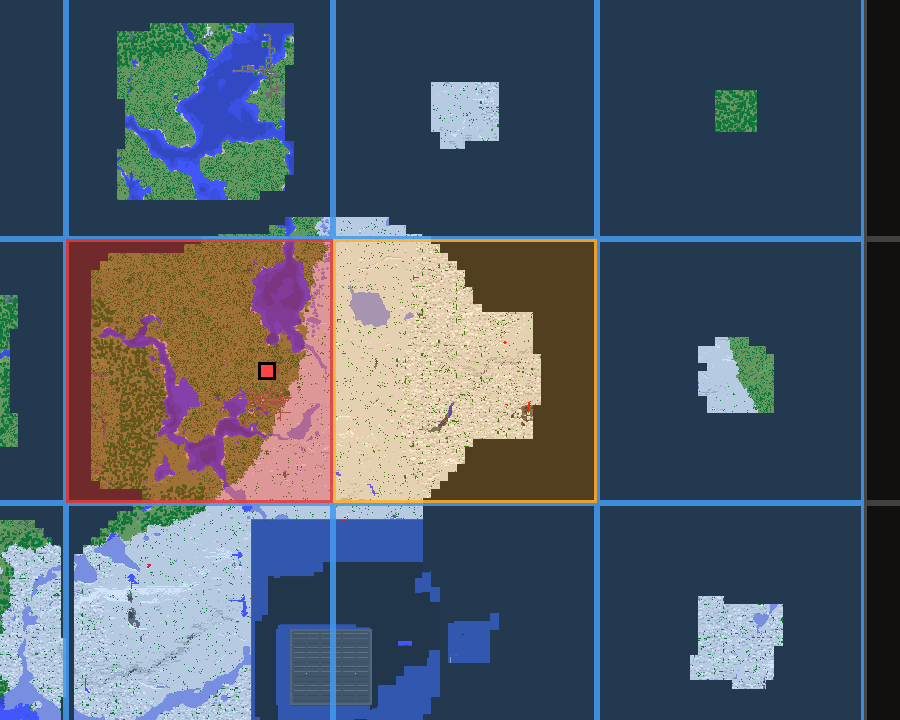

# RegionCast

[](https://github.com/CodeW4VE/RegionCast/actions/workflows/build.yml)
[](LICENSE)
[](https://fabricmc.net/)

Mantené al día un servidor espejo copiando solo las regiones que cambiaron, elegidas en un mapa.

*[Read in English](README.md)*



- Un mapa del mundo donde cada casilla es un region file: rojo si cambió desde la última copia,
  azul si nunca se copió, dorado si está en cola. Acercando, elegís chunks sueltos.
- Hacés click en lo que querés, tocás Actualizar, y el servidor reinicia con el terreno, los
  points of interest y las entidades nuevas.
- Las últimas 3 actualizaciones se pueden deshacer.
- Copia unos cientos de MB en vez del mundo entero: en un servidor real solo cambiaron 59 de 1812
  regiones (407 MB de 8 GB) en un día.

Sirve para copias en creativo, mundos de prueba, mundos para renderizar, o para enseñar una base
sin dejar entrar a nadie al servidor de verdad.

## Instalación

- Minecraft 1.21 / 1.21.1 o 26.3, Fabric y [Fabric API](https://modrinth.com/mod/fabric-api).
  Java 21 para 1.21; Java 25 y Fabric Loader 0.19.5+ para 26.3.
- El jar va en el servidor destino (el mirror). En tu cliente es opcional y agrega el mapa; sin
  él todo funciona por `/rc`.
- El servidor destino tiene que poder leer los archivos del mundo de origen (un VPS o una máquina
  dedicada; los hosts compartidos tipo Aternos no lo permiten). Montalo en solo lectura.
- Recomendado: RCON en el servidor de origen, y algo que reinicie el mirror cuando se pare (viene
  un [plugin de MCDReforged](mcdr/)).

Arrancá el servidor una vez para que se cree `config/regioncast.properties`, y poné `source_world`
y el RCON del origen. El paso a paso está en [Instalación en detalle](#instalación-en-detalle).

## Uso

```
/rc                    abre el mapa, o escribe el estado si no podés abrirlo
/rc map                abre el mapa (necesita el mod cliente)
/rc status             qué está desactualizado, qué hay en cola, qué backups hay
/rc here               encola la región en la que estás parado
/rc here chunk         encola solo el chunk en el que estás parado
/rc add <dim> <x> <z>  encola una por índice, dimensión -1, 0 o 1
/rc scan               relee el origen
/rc list               qué hay en cola
/rc clear              vacía la cola
/rc run                copia todo, y reinicia
/rc backups            lista las actualizaciones que se pueden deshacer
/rc restore [n]        devuelve una, y reinicia
```

En el mapa: click izquierdo encola o desencola, click derecho arrastrando mueve, la rueda hace zoom.
La cola sobrevive a un reinicio.

## Detalles

### Cómo funciona

- Un tile del mapa mide 512 por 512 bloques. Un region file mide 512 por 512 bloques. Así que un
  tile **es** una región, sin conversión en ninguna parte, y el mapa se dibuja con los chunks que
  tu cliente ya tiene.
- Los colores salen de un **ledger**, no de comparar los dos archivos. Comparar no funciona: la
  copia se lleva una fecha nueva, y el mirror reescribe sus propios region files en cuanto alguien
  camina por ahí. El ledger anota la fecha que tenía el archivo del *origen* al copiarlo, y compara
  las fechas futuras del origen contra esa.
- La copia ocurre **durante el apagado**. Un mod vive dentro del proceso de Minecraft, así que no
  puede parar el servidor, copiar y arrancarlo de nuevo: se estaría matando a mitad del trabajo. Lo
  que sí puede es copiar en `SERVER_STOPPED`, cuando el mundo ya está guardado y todos los region
  files cerrados, pero la JVM sigue viva. Algo de fuera vuelve a arrancar el servidor (ver
  [reiniciar después](#reiniciar-despues)).
- Antes de copiar se le manda `save-off` y `save-all flush` al servidor de origen por RCON, y
  `save-on` al terminar, con reintentos, porque dejar el servidor de otro sin guardar es peor que
  cualquier cosa que este mod intentara hacer.

### Chunks

Si te acercás lo suficiente, la rejilla pasa de regiones a chunks y el click elige un chunk suelto.
Sin botón de modo: a ese zoom una región es más ancha que la pantalla, y alejado un chunk es un
píxel, así que el gesto solo puede significar una cosa en cada momento.

Los chunks sueltos se copian distinto a las regiones enteras. Una región es una copia de archivo.
Un chunk se saca del region file del origen y se escribe dentro del nuestro, usando el `RegionFile`
del propio Minecraft, así que el resultado es byte por byte lo que habría escrito el juego. Lo que
ganás con eso es traerte una construcción sin los 512 bloques de terreno con los que comparte
archivo.

Lo que cuesta:

- **La luz y todo lo que cruza un borde de chunk** llega a medias hasta que el juego lo recalcula.
  Lo hace, pero se ve un momento, sobre todo en cuevas.
- **Más lento por bloque**: cada chunk se descomprime y se recomprime, y el region file del origen
  se copia antes a una carpeta de trabajo (`RegionFile` insiste en abrir su archivo en escritura, y
  el origen se supone montado en solo lectura). Siguen siendo segundos, no minutos.
- **El origen solo tiene fecha por region file entero**, así que un chunk solo se puede juzgar
  contra eso. Un cambio en cualquier parte de una región marca como desactualizados todos los
  chunks que sacaste de ella, hasta los que nadie tocó. Se equivoca hacia el lado que te dice que
  mires.

Los chunks copiados se pintan verdes, rojos cuando el origen sigue adelante, dorados mientras están
en cola.

### Backups

Cada actualización aparta los region files que va a reemplazar. Las últimas **3** se pueden
deshacer, y las más viejas se borran solas.

Un backup es una *actualización*, no una región: hacés click en unas cuantas regiones, le das a
Update, y más tarde decidís que esa tanda entera fue un error. Restaurar devuelve los archivos con
sus fechas originales y rebobina el ledger con ellos, así las regiones restauradas vuelven a
figurar como desactualizadas en vez de decir que coinciden con un origen con el que ya no
coinciden.

```
/rc backups          lista lo que se puede deshacer
/rc restore          devuelve la más reciente
/rc restore 2        devuelve la segunda más reciente
```

Restaurar toma el mismo camino que una actualización: se arma, el servidor reinicia, y los
archivos vuelven a su sitio con el mundo cerrado.

Dos cosas que conviene saber:

- **El disco.** Una tanda de 60 regiones cuesta más o menos lo que pesan esas 60 regiones, unos
  400 MB en un mundo con movimiento. Tres de esas pasan del giga. Mirá que tengas sitio, o bajá
  `backup_keep`.
- **Restaurar no hace backup de lo que sobreescribe.** Lo que tira una restauración es la copia que
  RegionCast trajo del origen, y es justo lo único de todo esto que siempre podés volver a traer
  dándole a Update.

### Instalación en detalle

Usá el jar correspondiente a **1.21 / 1.21.1** o **26.3**, junto con Fabric API para esa versión. Minecraft 26.3 necesita Java 25 y Fabric Loader 0.19.5 o superior; 1.21 necesita Java 21.

Conservá `config/regioncast.properties`, los datos de sincronización del mundo, los backups y la caché del mapa. La cola y los registros de copia se mantienen al reiniciar; la actualización no copia regiones automáticamente.

**Hacé visible el mundo de origen** para el servidor destino, en solo lectura. En Linux, un bind
mount al lado de la carpeta del mundo:

```bash
mount --bind -o ro /ruta/al/mundo/origen /ruta/al/mirror/smp_world
```

Metelo en `/etc/fstab` con `nofail` para que un origen ausente nunca impida arrancar el servidor.
RegionCast nunca escribe en el origen, pero montarlo en solo lectura significa que un bug de este
mod tampoco podría.

**Arrancá el servidor una vez.** Escribe `config/regioncast.properties`:

```properties
# ruta a la carpeta del mundo del que copiar, relativa a la del mundo o absoluta
source_world=../../smp_world

# el RCON del servidor de origen, para el save-off antes y el save-on después
rcon_host=
rcon_port=25575
rcon_password=

# nivel de operador necesario para abrir el mapa y encolar regiones
permission_level=3

# no dejar actualizar si hay otros jugadores conectados aquí
require_empty=false

# cuántas actualizaciones se pueden deshacer, 0 para no hacer backup nunca
backup_keep=3
backup_dir=../regioncast-backups
```

> El config va en la carpeta de config de **mods** del servidor destino. Si usás MCDReforged con
> `working_directory: server`, eso es `server/config/`, no el `config/` de MCDR que está al lado.

### Reiniciar después

El mod para el servidor para copiar, y escribe una última línea al salir:

```
[RegionCast] RESTART_REQUESTED
```

Cualquier cosa que vigile esa línea puede volver a arrancar el servidor. En [`mcdr/`](mcdr/) hay un
plugin de [MCDReforged](https://github.com/MCDReforged/MCDReforged) listo: copiá
`regioncast_restart.py` a tu carpeta `plugins/` de MCDR.

> Si usás MCDReforged, lo necesitás. Cuando el proceso del servidor termina por su cuenta, MCDR se
> apaga con él, y dentro de un container eso se lleva el container entero por delante. El plugin
> cancela eso en cuanto ve el marcador, que es mientras el servidor todavía se está apagando: para
> cuando corre `on_server_stop` la decisión ya está tomada.

### Errores comunes

- **No verifiques una copia comparando md5 entre los dos mundos.** Es exactamente la comparación
  que el ledger existe para evitar, y te va a decir que fallaron regiones que no fallaron: en el
  origen se sigue jugando, y el mirror reescribe su propia copia en cuanto se cargan esos chunks.
  Verificá por la línea de log de cada región (`copied 3 deleted 0`) y con `/rc scan`.
- **No copies el jar encima del servidor corriendo.** Java carga las clases de forma perezosa, así
  que reemplazar el jar por debajo de un servidor vivo hace que cualquier clase que todavía no
  hiciera falta ya no se pueda leer nunca. Pará el servidor, reemplazá el jar, arrancá.
- **Los mapas del Nether se ven como un techo gris** si los dibujás de arriba abajo. RegionCast
  arranca el escaneo a tu propia Y en las dimensiones con techo, y redibuja cuando te movés más de
  8 bloques en vertical.

## Compilar

```bash
./gradlew build
```

Necesita JDK 21. El jar sale en `build/libs/`.

Los paquetes `model` y `sync` no tienen ni una clase de Minecraft, a propósito, así que la copia,
el ledger, la cola, los backups y el protocolo RCON se testean todos contra carpetas temporales en
vez de contra un mundo de 13 GB. La única excepción es `anvil`, que tiene que hablar con el código
de region files de Minecraft, y se testea contra region files de verdad. 125 tests, que corren en
CI en cada push.

## Licencia

MIT. Ver [LICENSE](LICENSE).

Parte de [W4VE](https://github.com/CodeW4VE), Ware 4 Vanilla Experience.
